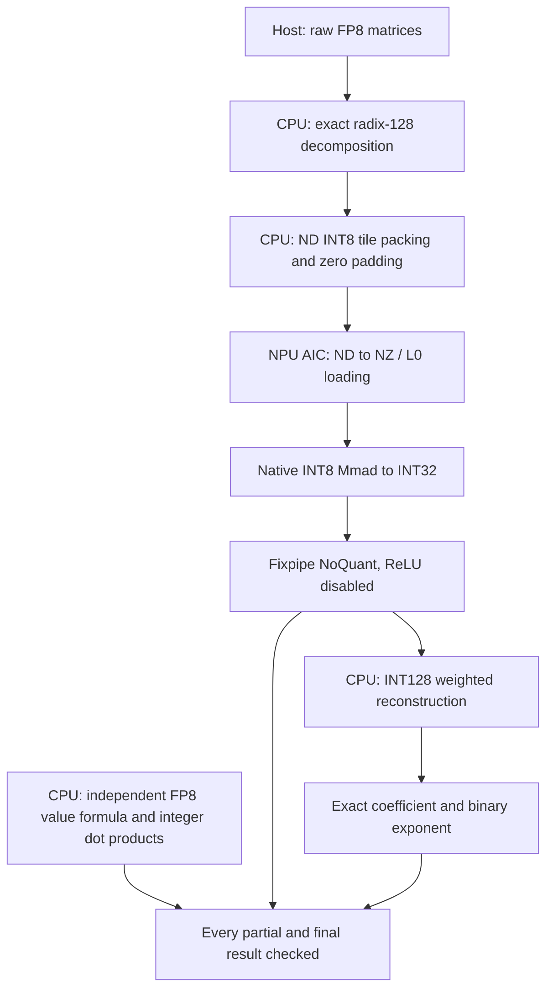

# Exact FP8 Matmul on Ascend 910C

**v1.0.0 · CANN 9.0.0 · Ascend C / C++17 · Correctness-first reference implementation**

Exact mathematical matrix multiplication of finite FP8 E4M3FN and E5M2 inputs on the Ascend 910C, using native INT8 Cube operations and wide integer reconstruction. The implementation does **not** perform approximate INT8 quantization, floating-point accumulation, or output rounding. It requires neither PyTorch nor native FP8 instructions.

The released kernel and host source are unchanged from the link-fix v2 implementation used in the supplied hardware validation. This is an independent prototype built using CANN APIs, not an official Huawei FP8 operator or a fully on-device implementation.

## Validation at a glance

| Metric | Reported hardware result |
|---|---:|
| Device | Ascend 910C, device 0, `dav-2201` |
| Toolkit | CANN 9.0.0 |
| Logical matrix shape | M=16, N=64, K=256/1024/4096/8192 |
| Maximum blocks per launch | 20 |
| Matrix test cases | 64/64 PASS |
| Checked INT32 partial outputs | 111,149,056; 0 mismatches |
| Checked exact final coefficients | 65,536; 0 mismatches |
| Input formats | E4M3FN, E5M2, both mixed orientations |

Source: [supplied NPU log](results/npu_device0_2026-11-25.log), dated 2026-11-25, with the terminal hostname redacted. See the [technical report](docs/TECHNICAL_REPORT.md), [case-level CSV](results/npu_cases.csv), and [audit output](results/npu_audit.txt). These figures describe the archived runs, not a new NPU execution by the release packager. CPU-only tests were separately rerun during packaging.

## Contents

- [Arithmetic contract](#arithmetic-contract)
- [Architecture](#architecture)
- [Requirements and quick start](#requirements-and-quick-start)
- [Tests and reproduction](#tests-and-reproduction)
- [Performance and limitations](#performance-and-limitations)
- [Repository layout](#repository-layout)
- [Troubleshooting](#troubleshooting)
- [References](#references)

## Arithmetic contract

For a finite raw FP8 byte, decode the sign S, exponent field E and mantissa M. For E4M3FN use `m=3, q=9`; for E5M2 use `m=2, q=16`.

```text
I = (-1)^S * (M                     if E == 0
              (2^m + M) * 2^(E-1)    otherwise)
x = I * 2^(-q)
```

All operations above are exact. Decompose the integer magnitude into radix-128 digits, applying the original sign to every digit:

```text
I = sum(d[i] * 2^(7*i)),  -127 <= d[i] <= 127
```

E4M3FN needs three planes, E5M2 five. For matrices A and B, let `P[i,j] = A_i @ B_j`, evaluated with native signed INT8 inputs and signed INT32 accumulation. Each partial matrix is a tile product; host reconstruction also sums over K tiles:

```text
C_int = sum_over_K_tiles_and_planes(P[i,j] * 2^(7*(i+j)))
C     = C_int * 2^(-(q_A + q_B))
```

| Input pair | Plane products per K tile | Output exponent |
|---|---:|---:|
| E4M3FN × E4M3FN | 9 | -18 |
| E4M3FN × E5M2 | 15 | -25 |
| E5M2 × E4M3FN | 15 | -25 |
| E5M2 × E5M2 | 25 | -32 |

The INT8 digits are an exact positional representation, not lossy quantization. The binary exponent is part of that representation, not a fitted scale. With TK=32, the conservative absolute bound per INT32 partial output is `32*127*127 = 516128`. Signed `__int128` is sufficient for every final coefficient in the supported K range. For K=8192, the largest possible coefficient needs 50, 64 or 78 signed bits for homogeneous E4M3FN, mixed, or homogeneous E5M2 respectively.

**Output:** a signed integer coefficient and a common binary exponent. The demo validates the entire matrix internally and prints `C[0,0]`; it does not currently expose a general library API or dump all output coefficients. Exactness refers to the mathematical product of finite represented inputs, not equality with any GPU's intermediate-rounded FP32 accumulation. Both signed zeros map to integer zero; NaN and infinity are rejected. External block/tensor scales are not implemented.

## Architecture



The ASC kernel computes one independent `16 x 32` by `32 x 64` tile per AIC block. The host groups up to 20 independent tile jobs per launch and gives each block disjoint GM regions. The last K tile is zero-padded. The kernel uses `DataCopy`, `LoadData`, `LoadDataWithTranspose`, `Mmad` and `Fixpipe` with `NoQuant`. It does not run the FP8 decoder or wide accumulator on AIV.

## Requirements and quick start

- Linux with compatible Ascend driver/firmware and an accessible Ascend 910C / Atlas A3 device.
- CANN 9.0.0 with Bisheng, ASC CMake modules, headers, ACL, and Ascend C host runtime libraries.
- CMake (3.20.5 was used in the supplied hardware log; CMakeLists declares 3.16 minimum), GNU-compatible C++17 compiler with `__int128`, GNU linker, Bash.
- Python 3 (standard library only) for log auditing; no Python needed for the matrix executable.

From the repository root, using the default toolkit path `/home/developer/Ascend/cann-9.0.0`:

```bash
bash run.sh 0 33 1 1
bash run.sh 0 256 1 20
bash run.sh 0 8192 1 20
```

Override the toolkit path if needed:

```bash
CANN_ROOT=/path/to/cann-9.0.0 bash run.sh 0 33 1 1
# Optional: ASC_DIR=/path/to/ASC/cmake/config
```

The script sources the toolkit environment if available, searches for the ASC package config, configures `dav-2201`, builds with verbose linking and runs the executable. `JOBS` controls build parallelism (default 4). Delete the old `build/` when switching toolkits.

```text
bash run.sh [device_id] [K] [rounds] [max_blocks]
Defaults: 0, 256, 1, 20
K: 1..8192; rounds: >=1; max_blocks: 1..20
M and N are fixed at 16 and 64 in this release.
```

Each round runs four ordered format pairs and four input patterns. Successful runs end with:

```text
FINAL: PASS (all checked integer results exact)
```

A numerical mismatch returns exit code 1; a caught runtime/argument error returns 2. Shell/build errors also fail the script.

## Tests and reproduction

### NPU correctness suite

```bash
for k in 256 1024 4096 8192; do
  bash run.sh 0 "$k" 1 20 || exit 1
done
```

Patterns: 0 = deterministic random finite bytes (MT19937 seed 910); 1 = maximum positive finite values; 2 = repeated large positive and negative products with tiny terms between; 3 = signed-zero inputs. Each execution checks all 256 codes per format (finite values plus rejected special codes) and every partial and final output, not just a final checkpoint.

### CPU-only regression test

```bash
bash cpu_test.sh 33 1 7
bash cpu_test.sh 8192 1 20
```

These tests emulate INT8 tiles on CPU. They do not use CANN or demonstrate NPU compatibility. The independent host reference evaluates FP8 values using their floating-point definition (each individual value and scaled integer is exactly representable in double), then uses signed `__int128` products and sums. It shares the finite-code classifier with the decoder. No floating-point accumulation is used.

### Audit the archived NPU log

```bash
python3 scripts/audit_log.py
python3 scripts/audit_log.py --csv /tmp/npu_cases.csv
sha256sum -c results/tested_source.sha256
```

The audit verifies all 64 expected case keys, output counts, zero mismatch reports, output exponents, deterministic printed coefficients and successful run summaries. It does not independently execute the NPU or verify all unprinted coefficients. GitHub Actions runs these checks and CPU emulation, not a hosted NPU job. The source hashes deliberately pin the hardware-tested release; update them only with appropriate provenance when changing source.

To test device 1, if present: `bash run.sh 1 8192 1 20`. Dual-device throughput is not validated. For simultaneous runs, build once, then invoke separate executable processes under the same configured CANN runtime environment; do not run concurrent builds in the same build directory.

## Performance and limitations

Observed median timing at K=8192 (four different input patterns; not repeated identical benchmarks):

| Format pair | Transfers + launch + synchronization | Checked wall time |
|---|---:|---:|
| E4M3FN × E4M3FN | 8.786 ms | 533.827 ms |
| E4M3FN × E5M2 | 14.375 ms | 830.139 ms |
| E5M2 × E4M3FN | 14.545 ms | 830.140 ms |
| E5M2 × E5M2 | 24.149 ms | 1324.311 ms |

`transfer_launch_seconds` measures `Engine::run`, including input copies, output poisoning, launch, synchronization and output copy. `checked_wall_seconds` starts after input generation, decoding and initial allocations; includes packing, transfer/launch, partial checks, reconstruction and final reference checks. Neither is pure Cube execution time or full application latency. No peak TOPS claim is made.

Known limitations: finite values only; loss of negative-zero sign; raw unscaled FP8; fixed output shape; small K tiles; host decode, reconstruction and checking; no native FP8 instruction or demonstrated full AIV path; no verified device-1 or dual-device performance. The next research steps are larger K accumulation on Cube, AIV LUT decoding, on-device wide reconstruction, dynamic matrix tiling and separate correctness/performance measurements. These are roadmap items, not released features.

## Repository layout

```text
fp8_exact_matmul_910c/
├── fp8_matmul.asc               # native INT8 Cube kernel and launch wrapper
├── main.cpp                    # host arithmetic, CPU reference, verification
├── config.h                    # tile sizes and max blocks
├── CMakeLists.txt               # ASC/CXX build with runtime link fix
├── run.sh                       # NPU build and run
├── cpu_test.sh                  # standalone CPU emulation
├── README.md
├── CHANGELOG.md
├── .gitignore
├── .github/workflows/cpu-validation.yml
├── docs/TECHNICAL_REPORT.md
├── scripts/audit_log.py
└── results/                     # logs, CSV, audit, source checksums
```

## Troubleshooting

**Undefined references to `StartAscendProf`, `AscendLaunchKernelWithHostArgs` or `AscendDevBinaryLazyRegister`:** use the included link-fix CMakeLists, which links `ascendc_runtime` ahead of dependencies using a linker group and scoped `--no-as-needed`. Verify your actual CANN library directory:

```bash
CANN_ROOT=${CANN_ROOT:-/home/developer/Ascend/cann-9.0.0}
nm -A --defined-only "$CANN_ROOT/lib64/libascendc_runtime.a" | grep -E 'StartAscendProf|AscendLaunchKernelWithHostArgs|AscendDevBinaryLazyRegister'
cat build/CMakeFiles/demo.dir/link.txt
```

**ASC package not found:** locate the toolkit `ASCConfig.cmake` or `asc-config.cmake` and set `ASC_DIR` to its directory. **Runtime or numeric error:** rerun `bash run.sh 0 33 1 1` and inspect the first error. Partial mismatches suggest a Cube/layout/transfer problem; final-only mismatches suggest reconstruction/reference issues.

## References

- [CANN 9.0.0 Mmad](https://www.hiascend.com/doc_center/source/en/CANNCommunityEdition/900/API/ascendcopapi/atlasascendc_api_07_0249.html)
- [CANN 9.0.0 Fixpipe](https://www.hiascend.com/doc_center/source/en/CANNCommunityEdition/900/API/ascendcopapi/atlasascendc_api_07_0251.html)
- [CANN 8.5 LoadDataWithTranspose, INT8 example](https://www.hiascend.com/doc_center/source/en/canncommercial/850/API/ascendcopapi/atlasascendc_api_07_0239.html)
- [Ascend C basic matmul example](https://gitcode.com/cann/asc-devkit/tree/master/examples/01_simd_cpp_api/00_introduction/02_matrix/matmul_basic_api)
- [OCP OFP8 specification](https://www.opencompute.org/documents/ocp-8-bit-floating-point-specification-ofp8-revision-1-0-2023-06-20-pdf)

The project does not bundle CANN or vendor libraries. Reference links are carried forward from development documentation; external links may change.

## Licensing and attribution

No license has been selected in this package. A public GitHub repository does not automatically grant open-source redistribution rights. The repository owner should select an appropriate license after confirming rights to the code and any third-party material. Ascend and CANN are Huawei technologies; this project is independent and is not endorsed by Huawei.
